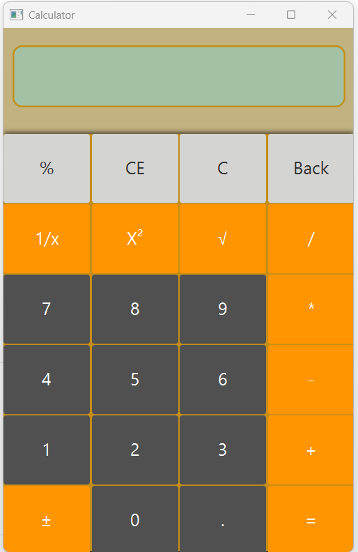

# 🧮 Calculadora Básica em Java

Uma calculadora simples desenvolvida em **Java** que executa as oito operações matemáticas básicas. Projeto ideal para praticar lógica de programação e sintaxe da linguagem.

## 🚀 Funcionalidades

*   **Soma** (+)
*   **Subtração** (-)
*   **Multiplicação** (*)
*   **Divisão** (/)
*   **Inversão** (1/x)
*   **Porcetagem** (%)
*   **Raiz quadrada** (√)
*   **Potência de dois** (x²)
*   **Inversão de Sinal** (±)
*   **Botão de cancelar entrada** (CE)
*   **Botão de limpar** (C)
*   **Botão Backspace** (Back)
*   **Inserção de Dot** (.)

## 🛠️ Tecnologias

*   **Java** (Versão 25 LTS)
*   **JavaFX 25** (para desenvolver interfaces gráficas)
*   **Scene Builder** (para geração do arquivo FXML)

## ➗ Divisão das Responsabilidades  
* CalculatoraApplication.java: instancia o stage, carrega o arquivo FXML e exibe a janela.
* calculator_view.fxml em resources: contém os arquivos .fxml criados no Scene Builder.
* CalculatorController.java: controla os elementos visuais do FXML através da anotação @FXML, escuta os cliques dos botões e faz validações.
* module-info.java: dá permissão para o JavaFX acessar os pacotes e declara quais módulos do JavaFX a aplicação requer.
* TipoOperação.java: realiza a lógica matemática, utilizando Enum para mapear o símbolo textual do botão clicado para a sua respectiva fórmula.
* Operacao.java: interface que define o comportamento da operação matemática, ou seja, se será de um ou dois números.

## ⚠️ Lógicas e validações

Dentro do CalculatorController existem lógicas que verificam o botão clicado para evitar:
* atribuir valor negativo ao número zero;
* realizar divisão por zero;
* evitar o clique repetido do dot (,) se já existir dot;
* atualizar o visor da calculadora para 0. quando o usuário clicar no botão dot antes de um botão numérico;
* se houver inversão de sinal, extração de raiz quadrada, inverso, elevação ao quadrado, ocorrerão instantaneamente sem o uso do botão igual;
* se uma operação for clicada duas vezes (tipo: + +) será ignorada pela lógica;

## 📦 Como Executar

1. Clone o repositório:
     
   https://git@github.com:JZanataNeto/Calculadora-Basica.git
    
2. Acesse a pasta do JAR executável para abrir em seu PC:
   
   ## Calculadora-Basica.jar

## 📝 Design e Layout

